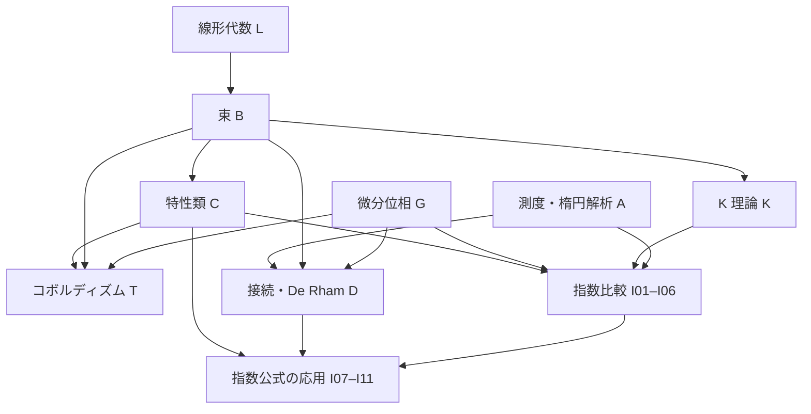

# 数学ライブラリのロードマップ

特性類、コボルディズム、複素 K 理論を育て、閉コンパクト多様体上の複素楕円作用素に対する Atiyah–Singer 指数定理と、その具体的な指数公式へ進む。
個別の `.md` が一つの実装タスクで、要件と直接依存するタスクを記述する。
このファイルは全体の範囲、見積もり、並列化と合流点を管理する。

## 出発点

2026-10-21 時点の既存ライブラリを基準にする。
基本群と被覆、ホモロジー代数、特異コホモロジーの計画は完了しており、[ライブラリ一覧](../../libs/README.md) の公開 API を土台にする。
接束・法束、微分形式、Clifford 代数、Spin・Spin-c の群、実 Gram–Schmidt も利用できる。
一般のベクトル束、管状近傍、境界付き多様体、特性類、K 理論は今回のタスクで構成する。
既存の Lp・Sobolev は主に定義で、Euclid 空間の Lebesgue 測度、完備性、Fourier 解析、楕円正則性も実装範囲に含める。
既存 API と重なる部分は実装時に比較して再利用する。
完了した単位は公開 API の README に移し、未完了の単位を以下のタスク一覧に残す。

## 到達点と証明の経路

特性類は有限 CW 底空間上の実・複素束を対象にし、Thom 同型、射影束定理、分裂原理から Chern・Stiefel–Whitney・Pontryagin・Euler 類と特性数へ進む。
コンパクト滑らかな多様体には、Morse 関数と handle 分解から得る有限 CW 型を通じて適用する。
接続と曲率による構成は別系統で進め、De Rham 比較を経て位相的特性類と一致させる。

コボルディズムは、非向き付き・向き付き・枠付きの群と積、Pontryagin–Thom 同型、特性数による不変量と非零な具体例までを第一段階にする。
Thom スペクトラムは有限 Grassmannian の Thom 空間と安定化から構成し、集合として表せる有限段階の代表を使う。

K 理論はコンパクト Hausdorff 空間の複素束から開始し、相対理論、Bott 周期性、コンパクト台、Koszul 複体による Thom 同型へ進む。
Bott 周期性は Laurent 近似・スペクトル分離・clutching による経路で証明する。
解析的指数はこの後に構成し、指数定理の証明と Bott 周期性の依存が循環しない構成にする。

指数定理は閉コンパクト滑らかな多様体と複素束間の楕円擬微分作用素を対象にする。
解析側は測度・Fourier・Sobolev・擬微分作用素・parametrix・Fredholm の順に進む。
位相側は Euclid 空間への埋め込み、余接束の法束の複素構造、Thom 写像と Bott 同型で位相的指数を作る。
切除と Thom 写像に対する解析的指数の可換性で両者を比較し、その後 Chern 指標による公式へ移る。
応用として Gauss–Bonnet、Hirzebruch の符号数公式、Spin-c Dirac 指数公式を扱う。

図は分野間の主な合流点を表す。
実際の着手可否は個別タスクの依存リストで判断する。
特性類と K 理論は共通の束基盤の後で並列に進み、指数定理の本体はコボルディズム環の計算を待たずに進められる。

## 見積もりと完了の単位

各タスクは証明・比較写像・利用例を含む新規または実質的に書き換える `.ref` の約5,000行を中心とした設計見積もりである。
表の値は千行単位で、文書や自動生成コードは別に扱う。
証明の粒度と既存 API の再利用で変わるため、実測前の目安はおおむね3,000〜7,000行とする。
粒度の参考として、現行の `field_kunneth` は約4,200行、`singular_products` は約3,200行の `.ref` で構成されている。
特に横断性、Bott の線形化、擬微分作用素、解析的 Thom 比較は見積もりの不確実性が大きい。
割り当て前に依存 API と証明経路を確認し、7,000行を大きく超える見込みなら、独立した補題の公開を完了条件にする追加タスクへ分割する。
一度割り当てたタスクは、その要件・自然性・具体例と依存閉包の検査までを一つの完了単位とする。

主な実装先の package 名は予定名で、分野内の既存の配置に合わせて配置する。
構成は実際の数学的対象から作り、存在・逆写像・等式・完全性の証明を含む公開 API にする。
定理の対象と仮定は命題内で量化し、構成データと法則を structure でまとめる。
必要な直接依存、workspace member、README と小さい利用例を更新し、[共有キャッシュ](../../src/USAGE.md#検査とキャッシュ)で対象と依存閉包を検査する。
上流の完了時には、その公開 API と検査結果を README に残し、下流タスクの依存リンクを対応する README に置き換えてから完了タスクを削除する。
参照先がまだタスクファイルなら実装待ち、README に移っていれば利用可能な依存として扱う。

## 並列での割り当て

依存タスクがすべて統合済みになったものを、空いているエージェントへ一件ずつ割り当てる。
各タスクは別の branch / worktree で作業し、主な実装先の package を担当範囲にする。
共通基盤の変更が必要なら、その API と担当タスクを先に合わせる。
`libs/ref.toml` とライブラリ一覧の変更は各 branch で検査できる形に含め、統合時に登録と依存関係をまとめて整合させる。
独立タスクの並列実装と、共有ファイルの統合の順序を分けて管理する。
下流のエージェントは上流が統合されるまで独立タスクを進め、統合後の公開 API に接続する。

初手に着手できるタスクは次のとおり。

- [A01 測度積分の収束定理](a01-measure-convergence.md)
- [A19 複素 Hilbert 空間とコンパクト作用素](a19-complex-hilbert.md)
- [B05 有限 Grassmannian と普遍束](b05-grassmannians.md)
- [C01 cap 積と相対積](c01-cap-products.md)
- [G01 滑らかな bump 関数と従属分割](g01-smooth-partitions.md)
- [G02 逆関数・陰関数と正則値の局所形](g02-inverse-implicit.md)
- [L04 対称多項式と特性級数](l04-symmetric-series.md)

L01 の行列式・逆行列、L02 の多項式分解、L03 の Hermitian 行列・局所枠が利用可能になり、G02 に着手できる。
B03 の計量・補束と同型類の集合が利用可能になり、B05 に着手できる。
B09 の [bundle_extension](../../libs/geometry/bundle_extension/README.md) は実・複素の Tietze、束・写像・同型の近傍延長、縮小比較と安定化を公開し、K03 で再利用できる。
K06 の連続なスペクトル分離は B04 の束比較の基盤となり、B04 の clutching と合わせて K07 で再利用できる。
K01 の Grothendieck 環・安定判定・反変引き戻しは K03・K07 で再利用する。
K04 の実・複素 Stone–Weierstrass、Laurent 近似と行列・束の一様評価も K07 で利用できる。
K07 の [clutching_linearization](../../libs/topology/clutching_linearization/README.md) は、選択に依存しないスペクトル逆クラス、自然性・直和・基本積の相互逆を公開し、K08 で利用できる。
K02 の [puppe_sequences](../../libs/topology/puppe_sequences/README.md) は、有限 CW 対の cofibration、自然な Puppe 列と反変 Hom の完全性を公開し、K03・B08・C02・T02 で利用できる。
K03 の [relative_k_theory](../../libs/topology/relative_k_theory/README.md) は、相対三つ組と被約群の比較、負次数の完全列、切除、Mayer–Vietoris、自然な外積と束の円板・球面対を公開し、K08 で利用できる。
B02 の束演算は B07・C05 でも利用でき、A01 の後は A02 へ進められる。
空いた担当には C01・L04・A19 を割り当て、長い解析の経路を早めに進める。
各節の番号は識別子で、実装順は依存リストから決まる。

## 完了した単位

| 単位 | 公開 API |
| --- | --- |
| L01 行列式と可逆行列 | [matrix_invariants](../../libs/algebra/matrix_invariants/README.md) |
| L02 多項式の互除法と Cayley–Hamilton | [polynomial_linear_algebra](../../libs/algebra/polynomial_linear_algebra/README.md) |
| L03 Hermitian 行列と連続な局所枠 | [hermitian_frames](../../libs/algebra/hermitian_frames/README.md) |
| K13 複素多項式の根の存在 | [fundamental_algebra](../../libs/algebra/fundamental_algebra/README.md) |
| K05 代数学の基本定理と根群の連続性 | [complex_polynomial_roots](../../libs/algebra/complex_polynomial_roots/README.md) |
| B01 一般の実・複素ベクトル束 | [vector_bundles](../../libs/geometry/vector_bundles/README.md) |
| B02 束の貼り合わせと線形演算 | [bundle_operations](../../libs/geometry/bundle_operations/README.md) |
| B03 束の計量・補束と集合による表示 | [bundle_complements](../../libs/geometry/bundle_complements/README.md) |
| K06 連続なスペクトル分離 | [spectral_splitting](../../libs/algebra/spectral_splitting/README.md) |
| B04 束のホモトピー不変性と clutching | [bundle_homotopy](../../libs/geometry/bundle_homotopy/README.md) |
| B09 閉部分空間からの束の延長 | [bundle_extension](../../libs/geometry/bundle_extension/README.md) |
| K01 束の Grothendieck 環 | [topological_k_theory](../../libs/topology/k_theory/README.md) |
| K04 Stone–Weierstrass と Laurent 近似 | [uniform_approximation](../../libs/analysis/uniform_approximation/README.md) |
| K07 clutching の安定線形化 | [clutching_linearization](../../libs/topology/clutching_linearization/README.md) |
| K02 CW cofibration と Puppe 列 | [puppe_sequences](../../libs/topology/puppe_sequences/README.md) |
| K03 相対 K 群と負次数の完全列 | [relative_k_theory](../../libs/topology/relative_k_theory/README.md) |

## タスク一覧

未完了77件、概算合計402千行。

### 線形代数と特性級数

1件、概算5千行。

| タスク | 概算（千行） |
| --- | ---: |
| [L04 対称多項式と特性級数](l04-symmetric-series.md) | 5 |

### ベクトル束

5件、概算26千行。

| タスク | 概算（千行） |
| --- | ---: |
| [B05 有限 Grassmannian と普遍束](b05-grassmannians.md) | 5 |
| [B06 束の分類写像と安定化](b06-bundle-classification.md) | 5 |
| [B07 滑らかな束と既存の接束・法束との接続](b07-smooth-bundles.md) | 5 |
| [B08 Grassmannian のセル分解](b08-grassmannian-cells.md) | 6 |

### 特性類

12件、概算60千行。

| タスク | 概算（千行） |
| --- | ---: |
| [C01 cap 積と相対積](c01-cap-products.md) | 5 |
| [C02 円板束・球面束と Thom 空間](c02-thom-spaces.md) | 5 |
| [C03 Thom 類と Thom 同型](c03-thom-isomorphism.md) | 5 |
| [C04 射影空間と標準線束のコホモロジー](c04-projective-cohomology.md) | 5 |
| [C05 射影束定理と分裂原理](c05-projective-bundle.md) | 5 |
| [C06 Chern 類](c06-chern-classes.md) | 5 |
| [C07 Stiefel–Whitney 類](c07-stiefel-whitney.md) | 5 |
| [C08 Pontryagin 類と Euler 類の比較](c08-pontryagin-euler.md) | 5 |
| [C09 Chern 指標と乗法的特性類](c09-chern-character-genera.md) | 5 |
| [C10 特性数と具体的な多様体](c10-characteristic-numbers.md) | 5 |
| [C11 Leray–Hirsch の比較](c11-leray-hirsch.md) | 5 |
| [C12 コンパクト台付きコホモロジー](c12-compact-support-cohomology.md) | 5 |

### 位相的 K 理論

5件、概算27千行。

| タスク | 概算（千行） |
| --- | ---: |
| [K08 Bott の基本積定理](k08-bott-product.md) | 5 |
| [K09 Bott 周期性と整数次数](k09-bott-periodicity.md) | 5 |
| [K10 コンパクト台付き K 理論とシンボルの表示](k10-compact-support-k.md) | 6 |
| [K11 K 理論の Thom 同型](k11-k-thom.md) | 5 |
| [K12 Chern 指標と Thom 類の比較](k12-chern-character-thom.md) | 6 |

### 微分位相

13件、概算67千行。

| タスク | 概算（千行） |
| --- | ---: |
| [G01 滑らかな bump 関数と従属分割](g01-smooth-partitions.md) | 5 |
| [G02 逆関数・陰関数と正則値の局所形](g02-inverse-implicit.md) | 5 |
| [G03 境界・角付き多様体](g03-boundary-manifolds.md) | 5 |
| [G04 collar と境界の貼り合わせ](g04-collars-gluing.md) | 5 |
| [G05 コンパクト多様体の埋め込み](g05-compact-embeddings.md) | 5 |
| [G06 管状近傍と collapse 写像](g06-tubular-neighborhoods.md) | 5 |
| [G07 Sard の定理](g07-sard.md) | 6 |
| [G08 滑らかな近似と相対横断性](g08-transversality.md) | 6 |
| [G09 Morse 関数と非臨界区間](g09-morse-functions.md) | 5 |
| [G10 handle 分解と有限 CW 型](g10-handles-finite-cw.md) | 5 |
| [G11 向きと基本類](g11-fundamental-classes.md) | 5 |
| [G12 Poincaré–Lefschetz 双対性](g12-poincare-duality.md) | 5 |
| [G13 Morse 補題の局所解析](g13-morse-lemma.md) | 5 |

### コボルディズム

6件、概算31千行。

| タスク | 概算（千行） |
| --- | ---: |
| [T01 幾何学的コボルディズム群と積](t01-geometric-bordism.md) | 5 |
| [T02 安定ホモトピー類と Thom スペクトラム](t02-stable-thom.md) | 6 |
| [T03 Pontryagin–Thom の collapse 写像](t03-pontryagin-thom-collapse.md) | 5 |
| [T04 Pontryagin–Thom 同型](t04-pontryagin-thom-isomorphism.md) | 6 |
| [T05 特性数のコボルディズム不変性](t05-bordism-invariants.md) | 5 |
| [T06 コボルディズムの具体的な計算](t06-bordism-examples.md) | 4 |

### 接続と微分形式

5件、概算25千行。

| タスク | 概算（千行） |
| --- | ---: |
| [D01 接続と共変微分](d01-connections.md) | 5 |
| [D02 曲率と Chern–Weil 類](d02-chern-weil.md) | 5 |
| [D03 多様体上の積分と Stokes](d03-integration-stokes.md) | 5 |
| [D04 De Rham の比較定理](d04-de-rham-comparison.md) | 5 |
| [D05 位相的特性類と特性形式の一致](d05-characteristic-form-comparison.md) | 5 |

### 測度・関数解析・楕円作用素

19件、概算103千行。

| タスク | 概算（千行） |
| --- | ---: |
| [A01 測度積分の収束定理](a01-measure-convergence.md) | 5 |
| [A02 Euclid 空間の Lebesgue 測度](a02-lebesgue-measure.md) | 6 |
| [A03 積測度と Fubini](a03-product-integration.md) | 5 |
| [A04 多重積分の変数変換](a04-change-of-variables.md) | 6 |
| [A05 Lp 空間のノルムと完備性](a05-lp-completeness.md) | 5 |
| [A06 Schwartz 空間と Fourier 変換](a06-schwartz-fourier.md) | 6 |
| [A07 Plancherel と Fourier 乗算作用素](a07-plancherel.md) | 4 |
| [A08 分布と弱微分](a08-distributions.md) | 5 |
| [A09 Euclid 空間の Sobolev 評価](a09-euclidean-sobolev.md) | 6 |
| [A10 Rellich コンパクト性](a10-rellich.md) | 5 |
| [A11 Fredholm 作用素と指数](a11-fredholm-operators.md) | 5 |
| [A12 束切断の Sobolev 空間](a12-bundle-sobolev.md) | 5 |
| [A13 シンボルと局所量子化](a13-symbol-quantization.md) | 6 |
| [A14 擬微分作用素の合成と座標変換](a14-symbol-calculus.md) | 6 |
| [A15 擬微分作用素の Sobolev 有界性](a15-pseudodifferential-bounds.md) | 6 |
| [A16 楕円 parametrix と正則性](a16-elliptic-parametrix.md) | 6 |
| [A17 楕円作用素の解析的指数](a17-elliptic-fredholm.md) | 5 |
| [A18 Bott 作用素の解析的正規化](a18-bott-operator.md) | 6 |
| [A19 複素 Hilbert 空間とコンパクト作用素](a19-complex-hilbert.md) | 5 |

### 指数定理と応用

11件、概算58千行。

| タスク | 概算（千行） |
| --- | ---: |
| [I01 シンボルの K 類と解析的指数写像](i01-symbol-index.md) | 5 |
| [I02 解析的指数の局所化と切除](i02-analytic-excision.md) | 6 |
| [I03 解析的指数と Thom 写像](i03-analytic-thom.md) | 6 |
| [I04 位相的指数写像](i04-topological-index.md) | 5 |
| [I05 Atiyah–Singer 指数定理](i05-atiyah-singer.md) | 4 |
| [I06 コホモロジーによる指数公式](i06-cohomological-index.md) | 5 |
| [I07 Hodge 理論と符号数作用素](i07-hodge-signature.md) | 6 |
| [I08 Spin-c Dirac 作用素](i08-spin-dirac.md) | 5 |
| [I09 Gauss–Bonnet・符号数・Dirac 指数公式](i09-index-applications.md) | 6 |
| [I10 複素スピノル表現](i10-spinor-representations.md) | 5 |
| [I11 Spin・Spin-c 構造とスピノル束](i11-spin-structures.md) | 5 |

## 合流して確認する成果

| 合流点 | 完了タスク | 得られるもの |
| --- | --- | --- |
| 共通の束基盤 | B03・B04・B07 | 同型類の集合、補束、ホモトピー不変性、既存の接束・法束との比較 |
| 位相的特性類 | C08・C09・C10 | 整数・mod 2・有理特性類、特性数、射影空間の計算 |
| 位相的 K 理論 | K09・K11・K12 | 周期性、コンパクト台の Thom 同型、Chern 指標による比較 |
| コボルディズム | T04・T05・T06 | Pontryagin–Thom 同型、不変量、具体的な非零類 |
| 特性形式 | D05 | 位相的特性類と曲率形式の一致 |
| 解析的指数 | A17・I01 | 楕円作用素の Fredholm 性とシンボルの K 群上の指数 |
| 指数定理 | I05・I06 | 解析的指数と位相的指数の一致、コホモロジー表示 |
| 指数公式の応用 | I09 | Euler 標数・符号数・Spin-c Dirac 指数の特性類による公式 |

## その後の展開

非向き付きコボルディズム環の全計算、向き付きコボルディズムのねじれ、複素コボルディズム MU と形式群は、Steenrod 演算・スペクトル系列・安定ホモトピーの追加計画として展開する。
実 K 理論と8周期性、KO による実指数と mod 2 指数、外冪・Adams 演算を次の K 理論の段階に置く。
指数定理の先には、複素多様体と Dolbeault 理論から Hirzebruch–Riemann–Roch、族の指数、同変指数、境界と APS 指数、熱核による局所指数公式を置く。
各段階は必要な基盤が見えた時点で、同じ粒度の個別タスクへ展開する。

## 参照する証明

束・特性類・Bott の経路は [Hatcher, Vector Bundles & K-Theory](https://pi.math.cornell.edu/~hatcher/VBKT/VB.pdf) を参照する。
特性類・Thom 空間・コボルディズムの接続は [Haynes Miller, Algebraic Topology II](https://ocw.mit.edu/courses/18-906-algebraic-topology-ii-spring-2020/pages/lecture-notes/) を参照する。
指数の埋め込み・切除・Thom 写像による構成は [Landweber, K-theory and elliptic operators](https://arxiv.org/abs/math/0504555) とそこで参照される Atiyah–Singer の証明を照合先にする。
このタスク分割と行数は既存ライブラリを踏まえた設計上の見積もりである。
